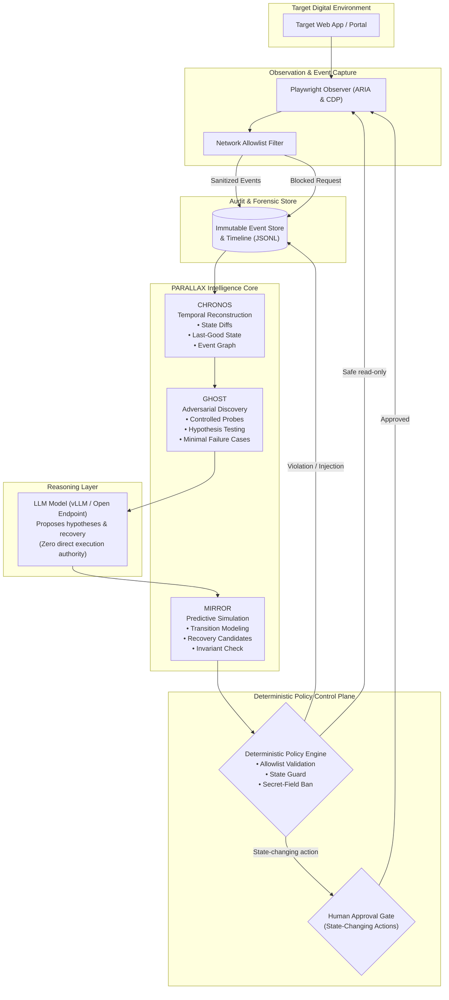
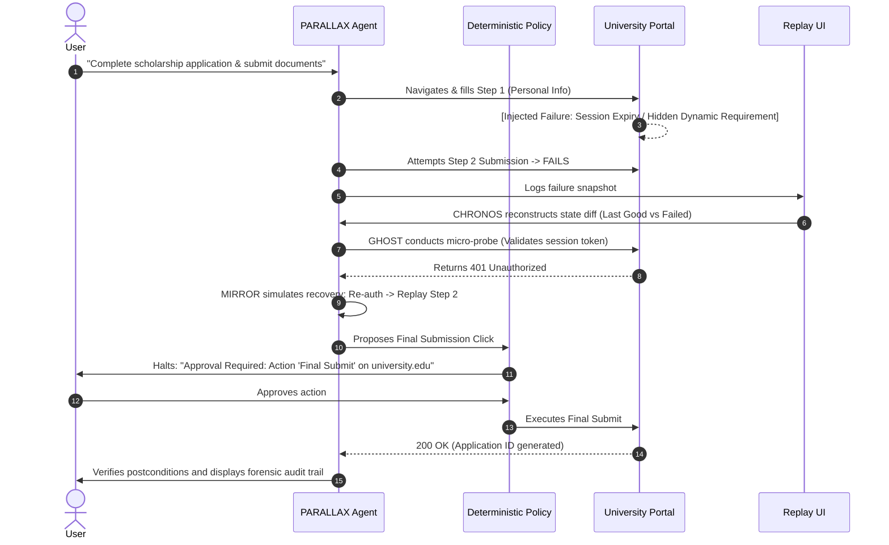

# PARALLAX
### Autonomous Digital Reality Intelligence

> **Observe the present. Reconstruct the past. Challenge the system. Simulate the future. Verify every action.**

[](#)
[](#)
[](#)
[](#)
[](#)

---

## 1. Executive Summary

> **In one line:** a safety layer for AI browser agents that blocks dangerous actions, explains failures and records everything. Measured before/after: run `npm run eval` in `parallax/` (14 attack techniques: 14 run unguarded, 0 with PARALLAX). Details: [`parallax/docs/submission/BEFORE_AFTER.md`](parallax/docs/submission/BEFORE_AFTER.md).

Autonomous web agents are rapidly evolving from passive assistants into active decision-makers that navigate multi-step web applications, fill out forms, and trigger transactions. However, when deployed in complex, untrusted web environments, existing browser agents suffer from three fundamental flaws:
1. **Fragile State Recovery:** When a web workflow fails (due to session timeouts, async validation errors, or dynamic DOM shifts), agents hallucinate explanations and get stuck in endless retry loops.
2. **Vulnerability to Hijacking:** Untrusted web pages containing prompt injections can manipulate an LLM agent into leaking data, navigating to malicious domains, or executing unauthorized transactions.
3. **Zero Forensic Auditability:** Most agents operate as black boxes, leaving zero reproducible evidence of what happened, what changed, or why an action failed.

**PARALLAX** solves this by establishing an evidence-grounded intelligence runtime and deterministic governance layer over browser automation. Rather than trusting an LLM with unrestricted execution, PARALLAX reconstructs state transitions, runs controlled micro-experiments to isolate failure causes, simulates recovery paths, and enforces immutable security invariants through a deterministic policy engine.

---

## 2. Core Architecture: The Tri-Engine Model

PARALLAX bridges browser automation (Playwright) and language models with three specialized intelligence engines linked by an append-only temporal provenance graph:



### 1. CHRONOS — Temporal Intelligence
* **State Diffing:** Continuously records DOM state snapshots (`ariaSnapshot`), network exchanges, and local storage transitions into an append-only event stream.
* **Failure Pinpointing:** When an invariant fails, CHRONOS backtracks the provenance graph to isolate the exact delta between the **Last-Good Known State** and the point of failure.
* **Separation of Fact and Inference:** Never relies on LLM speculation; facts are grounded in cryptographic hashes and timestamped event records.

### 2. GHOST — Adversarial Experimentation
* **Hypothesis Discrimination:** Instead of guessing why an operation broke, GHOST executes safe, isolated micro-experiments on the workflow (e.g., testing whether an error is caused by an expired authentication token vs. a missing required form field).
* **Failure Minimization:** Strips away extraneous workflow steps to yield a minimal reproducible test case.

### 3. MIRROR — Predictive Simulation
* **Candidate Comparison:** Simulates possible recovery pathways before performing them on the live target.
* **Pre-flight Invariant Checking:** Verifies that a proposed recovery action does not violate business invariants or trigger unintended side-effects.

---

## 3. Security & Safety Model

> **Core Philosophy:** Security is enforced via **capabilities and deterministic boundaries**, not statistical prompt filtering.

Current industry approaches rely on asking LLMs to detect malicious inputs. Attackers consistently bypass prompt defenses. PARALLAX adopts a **zero-trust, fail-closed architecture**:

| Threat Vector | Industry Failure Mode | PARALLAX Deterministic Defense |
| :--- | :--- | :--- |
| **Data Exfiltration** | LLM persuaded to fetch attacker URL | **Strict Network Allowlist:** Browser network engine rejects and logs all requests outside whitelisted hosts at the CDP level. |
| **Unauthorized Action** | Agent clicks "Confirm Payment" or "Delete" | **DOM-Grounded Human Gate:** Any state-changing selector (`submit`, `pay`, `apply`, `delete`) halts execution until confirmed by a human in the UI. |
| **Credential Hijacking** | LLM reads or autofills passwords/OTPs | **Secret-Field Ban:** Playwright instrumentation blocks LLM access to `<input type="password">`, credit card inputs, and 2FA tokens. |
| **Hallucinated Recovery** | Agent enters retry loops, compounding errors | **State Verification:** Every recovery action must satisfy mathematical postconditions verified against target backend state. |

---

## 4. Repository Structure

```text
parallax/
├── demo-app/               # Controlled synthetic target environment
│   ├── pages/              # Multi-step university admission portal UI
│   ├── server/             # Deterministic backend state machine
│   ├── failures/           # Injectable failure modes (session expiry, dynamic dependencies)
│   └── fixtures/           # Synthetic personas and test datasets (zero PII)
├── src/
│   ├── capture/            # Playwright browser observer & CDP network filter
│   ├── core/               # Typed event contracts, state model, diff engine
│   ├── chronos/            # Temporal reconstruction & provenance graph
│   ├── ghost/              # Hypothesis generator & controlled experiment runner
│   ├── mirror/             # Transition simulator & candidate ranker
│   ├── policy/             # Deterministic security rules, allowlist, human gate
│   ├── planner/            # Bounded recovery plan search
│   ├── verify/             # Postcondition verifier against backend state
│   └── llm/                # Model client (proposals only; no execution authority)
├── ui/                     # Command center dashboard (Timeline, Hypotheses, Approval)
├── tests/
│   ├── unit/               # Normalization, event validation, graph traversal
│   ├── integration/        # Browser capture to event store pipeline
│   ├── security/           # Prompt injection, exfiltration, and allowlist tests
│   └── e2e/                # End-to-end failure injection and recovery loops
├── docs/                   # Master technical specifications & architecture decision records
└── deploy/                 # Deployment guides (GPU server / local sandbox)
```

---

## 5. Demonstration Workflow (wHACKiest 2026)

Our MVP targets a high-stakes, multi-step digital workflow: a **Synthetic University Application & Scholarship Portal**.



---

## 6. Getting Started

### Prerequisites
* **Node.js**: `v20.x` or `v22.x LTS` (or `v25.x`)
* **TypeScript**: `v5.5+`
* **Python**: `3.11+` *(for backend simulation / doc verification)*
* **Playwright**: `v1.48+` / `v1.65`

### 1. Clone & Install
```bash
git clone https://github.com/BL4CK-0PS/PARALLAX.git
cd PARALLAX/parallax

# Install dependencies
npm install
npx playwright install chromium
```

### 2. Configure Environment
Create a `.env` file in `parallax/`:
```env
PORT=3000
HOST=127.0.0.1
LLM_ENDPOINT=http://localhost:8000/v1
LLM_MODEL=qwen-2.5-coder-32b
NETWORK_ALLOWLIST=localhost,127.0.0.1,demo-university.local
```

### 3. Run the Synthetic Target App
```bash
npm run demo:server
# Synthetic application launches on http://localhost:3000
```

### 4. Launch the PARALLAX Engine & UI
```bash
npm run dev
# Command Center dashboard launches on http://localhost:5173
```

### 5. Execute Security & Guard Test Suite
```bash
npm run test:security
```
Tests pass when:
- Every off-allowlist request in the suite is aborted by the network guard.
- All state-changing clicks trigger a blocking human approval prompt.
- Password and secret fields are scrubbed from LLM inputs.

---

## 7. Engineering Discipline & Constraints

* **Strict Non-Causal Language:** We distinguish between observation and cause. System logs record events as `observed before`, `associated with`, or `supports hypothesis`, avoiding unsubstantiated causal claims without controlled interventional evidence.
* **Deterministic Control Over AI:** The LLM is strictly an advisory engine. It has zero native ability to execute shell commands, fire unmonitored HTTP requests, or bypass the policy guard.
* **Reproducibility:** Every run outputs a standalone JSONL timeline that can be replayed frame-by-frame with zero external dependencies.

---

## 8. Team & Submission Details

* **Hackathon:** [wHACKiest 2026](https://devnovate.co/event/whackiest) — Ramaiah Institute of Technology (CodeRIT), Bengaluru
* **Track:** **Track 2 — Beyond the Browser**
* **Team Name:** `BL4CK_0P$`
* **Institution:** Sri Ramakrishna Engineering College (SREC)
* **Master Specification:** See [PARALLAX_Technical_Master_Specification.docx](file:///C:/Users/Kishanth/Downloads/bengaloure/PARALLAX_Technical_Master_Specification.docx)
* **Strategy & Game Plan:** See [WINNING_PLAYBOOK.md](file:///C:/Users/Kishanth/Downloads/bengaloure/WINNING_PLAYBOOK.md)

---

## 9. License

This project is licensed under the [MIT License](LICENSE) — see the LICENSE file for details.
