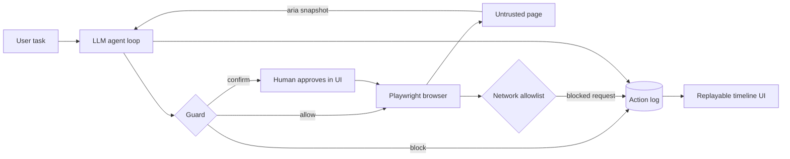

# wHACKiest 2026 — Winning Playbook (Team BL4CK_0P$)

Status: planning only. No project code is final. Today = 22 Nov 2026.
Legend: **[FACT]** read from organiser files/site · **[ASSUMPTION]** my inference · **[UNKNOWN]** not published.

---

## 1. Hard facts (organiser files + site)

| Item | Detail |
|---|---|
| Event | wHACKiest 2026, CodeRIT, Ramaiah Institute of Technology, Bengaluru **[FACT]** |
| Format | National, 24h **offline** hackathon, 1–2 Dec 2026; kick-off 1 Dec 00:00 IST; demo + evaluation 2 Dec **[FACT]** |
| Team | 2–4 undergrads (1st–3rd year), same college, one team per student, college ID card required **[FACT]** |
| Prize pool | ₹1,50,000 total; split + special awards "to be announced" **[FACT]** |
| Bonus awards | "Best Use of ElevenLabs", "Best Use of AWS" **[FACT]** (ideathon guide) |
| Registration | Devnovate (devnovate.co/event/whackiest). **Closes 24 Nov, 11:59 PM IST, PPT included** **[FACT]** |
| Round 1 (online) | Pitch 26–27 Nov: **5 min present + 3 min Q&A** **[FACT]** |
| Shortlist | 28 Nov (/shortlisted page) **[FACT]** |
| Round 1 judged on | "the problem, your solution and why it matters"; prototype/MVP "gives an edge" **[FACT]** |
| Scoring rubric / weights | **[UNKNOWN]** — not published anywhere I could read |
| Track 4 (UnlockED) brief | **[UNKNOWN]** — not in tracks PDF |

### Submission package (all via Devnovate only — other channels not accepted)
1. **PPT**: use the provided template, **no extra slides**, file name `TeamName_TrackNumber` (use `BL4CK_0P_Track2.pptx`; drop the `$`), upload to Google Drive, "Anyone with the link can view", submit the link.
2. **Public GitHub repo** with early codebase/MVP.
3. **YouTube video** (public or unlisted), **3–5 min**: problem, solution, technical approach, quick prototype walkthrough.
4. **Team details** filled exactly as the template asks (name, college, track, team ID, members + USN).

Template slides (8, in order): Title/Team · Problem Statement · Proposed Solution · Tech Stack · Process Flow/Architecture · Novelty/Innovation · Impact & Feasibility · Business Model.

---

## 2. Open risks to close TODAY (22 Nov)

- [ ] **Eligibility.** You said integrated M.Tech, 2nd year. Site says "undergraduates". **[UNKNOWN]** whether integrated counts. Email `coderit@msrit.edu`: *"Integrated M.Tech (CSE), 2nd year, SREC. Eligible?"* Keep the reply.
- [ ] **Second teammate** (name, year, USN). Must be 1st–3rd year at SREC.
- [ ] **Create the team on Devnovate now** so you see the real form fields. Do not wait for the PPT.
- [ ] Confirm `$` is accepted in the team name; otherwise use `BL4CK_0PS` everywhere.
- [ ] Ask organisers: is a self-hosted GPU server reachable from the venue allowed? Is venue Wi-Fi reliable? **[UNKNOWN]**

---

## 3. Track decision

**Track 2 — Beyond the Browser** (browser agents that navigate, compare options and finish tasks).

Honest rating of my first idea (phishing detector): **4/10** — off-brief, crowded (Chrome/Gemini already do it).

**Chosen idea: "Tripwire" — a web-task agent you can trust and audit. Rating: 6.5/10.**
- Gap: agents act on untrusted pages; hidden instructions can hijack them; afterwards nobody can say what the agent did.
- Fit with track: the agent genuinely navigates, compares and completes tasks.
- Fit with you: your DFIR/timeline-reconstruction experience is the differentiator.

Why not 8+: browser agents are flaky; "trust layer" is a pitch, not a product, unless the demo proves it. The demo is the product.

---

## 4. Product spec

**User:** a student/ordinary user delegating web tasks (compare and apply to internships/scholarships, compare products and prepare an order).
**Value:** gets the task done, is asked before anything irreversible, can replay exactly what the agent did.

### Security model (the core claim — keep it simple and true)
Security = **capabilities, not detection.**
1. **Network allowlist** enforced in the browser (every request to a non-allowed host is aborted and logged). Stops exfiltration and off-site hijack even if the model is fooled.
2. **Confirmation gate** for state-changing clicks (buy/submit/apply/delete…). Label read from the real DOM, never from the model.
3. **Secret-field ban**: agent can never type into password/card/OTP fields.
4. **Untrusted-content framing** of page text in the prompt (defense-in-depth only).
5. **Injection heuristic** is a *hint on the timeline*, never enforcement.
6. **Full action log** → replayable timeline UI.

Do NOT claim "prevents prompt injection." Claim: "a hijacked agent cannot leave the allowlist, spend money, or type secrets without a human, and every step is recorded."

### Stack (versions verified from registries on 22 Nov 2026)
- Node v25.9.0 locally (non-LTS — check server Node version), Playwright **1.65.1**, TypeScript **7.0.2**, `@types/node` 26.x.
- `page.ariaSnapshot({ mode: "ai" })` gives `[ref=eN]` references (confirmed in installed types). Clicking by ref via `aria-ref=` selector is **[ASSUMPTION] — verify with a test before relying on it**.
- LLM: OpenAI-compatible endpoint served by vLLM (**0.34.0** latest on PyPI).
- No UI framework: one static HTML page + SSE. No database: JSONL run logs.

### Model for 2× L40 (48 GB each, 96 GB total) — **[UNKNOWN] until benchmarked**
Candidates from web sources (vendor blogs, not independent; names must be verified on Hugging Face): gpt-oss-120b (~63 GB 4-bit), Qwen3.5-122B-A10B, Gemma 4 31B, Qwen3-Coder-Next. Cautions:
- L40 is Ada generation; native low-bit format support may differ from Hopper/Blackwell **[ASSUMPTION — check vLLM docs]**.
- L40s over PCIe (no NVLink assumed) → tensor-parallel overhead.
- Check each model card for the correct `--tool-call-parser`.
- **Selection rule (decide before seeing results):** run 20 scripted tasks on your fixtures; pick the model with highest valid-tool-call rate and task success, tie-break on latency. Baseline to beat: a small model on one GPU.

### Demo reliability (biggest practical risk)
- Offline venue + remote server = single point of failure. Required: (a) SSH tunnel tested from a different network, (b) **pre-recorded full demo video as fallback**, (c) a laptop-runnable path (smaller model or recorded run).
- Demo against **fixtures you control** + one real site. Never depend on a live third-party site alone.
- Bind the UI to `127.0.0.1`; reach it via SSH tunnel. The confirm endpoint has no auth — never expose it publicly.

---

## 5. Definition of done

**Round 1 (submit by Tue 24 Nov 6 PM; hard limit 11:59 PM):**
- [ ] One task runs end-to-end on video.
- [ ] Injection fixture page: hijack attempt → exfil request **blocked**, buy click → **confirmation shown**, both visible in timeline.
- [ ] Unit tests for guard pass (written: `tripwire/test/guard.test.ts`, **not yet run**).
- [ ] Public repo with README (what, how to run, honest limits).
- [ ] 8-slide PPT per template, Drive link public.
- [ ] 3–5 min YouTube video.
- [ ] Everything submitted on Devnovate; screenshot of confirmation.

**24h sprint (1–2 Dec):** polish, 2nd task, voice confirm (optional), rehearsed 5-min demo, offline fallback.

---

## 6. Timeline (3 days)

| When | Goal | Exit proof |
|---|---|---|
| **Sun 22 Nov** | Close §2 risks; register team; pick model path; start core loop | Team exists on Devnovate; eligibility email sent |
| **Mon 23 Nov** | Core loop + guard + log + fixtures working; injection demo green | Recorded 60-s clip of block + confirm |
| **Tue 24 Nov AM** | PPT, README, repo public | Drive link opens in incognito |
| **Tue 24 Nov PM** | Video recorded, uploaded, everything submitted by **6 PM** | Devnovate confirmation |
| 26–27 Nov | Pitch (5 + 3 min) | Rehearsed 3× with timer |
| 1–2 Dec | Sprint + demo | — |

Rule: if a feature isn't on the §5 list, it waits until after Round 1. No redesigns, no tooling detours.

---

## 7. PPT content (fill the 8 template slides; no extras)

1. **Title/Team** — Team BL4CK_0P$, SREC, Track 2, Team ID (from Devnovate), members + USN.
2. **Problem** — One line: web agents act on untrusted pages and leave no trustworthy record. Who: anyone delegating web tasks. Why it matters: cite a **real, sourced** incident/stat — find one before writing; do not invent numbers. Existing solutions and gaps: agent products optimise capability; few enforce hard limits + audit.
3. **Solution** — "Agent that does the task, asks before irreversible steps, and shows a replayable timeline." Features: allowlist, confirm gate, secret ban, timeline. User flow: task → agent runs → approve/deny → replay. MVP in 24h: comparison + apply/buy flow with guard.
4. **Tech stack** — Playwright, TypeScript, vLLM on 2×L40, JSONL + SSE UI. One-line reason each. Mention self-hosting = privacy + no per-token cost.
5. **Architecture** — the §4 diagram, labelled with tech.
6. **Novelty** — comparison table vs. typical browser agents on: hard network limits, human gate, forensic timeline, self-hosted. **Only claim what you verified** — research 2–3 real competitors first.
7. **Impact & feasibility** — measurable outcomes (e.g. "N/N injection attempts blocked in test suite", steps replayable). Risks: flaky sites, model errors → mitigations: fixtures, confirm gate, step limit.
8. **Business model** — keep honest and short: freemium/self-hosted for individuals, paid for teams needing audit logs (B2B). **[ASSUMPTION]** no market-size number unless sourced.

## 8. Video script (≈4 min)
0:00 problem (20 s) → 0:20 live task running (60 s) → 1:20 hijack attempt blocked, show timeline (60 s) → 2:20 confirm-gate on "Buy" (30 s) → 2:50 architecture (30 s) → 3:20 what's next + limits (30 s).

## 9. Pitch day (26–27 Nov, 5 + 3 min)
- Lead with the demo, not the slides. One sentence problem, then show.
- Prepared answers: "How is this different from prompt-injection filters?" (capabilities, not detection) · "What if the model is fooled?" (it still can't leave allowlist/spend) · "What doesn't it stop?" (**state this yourself**: data inside allowed sites, social engineering of the human).
- Honest limits stated up front score trust.

## 10. Bonus awards (optional)
- **ElevenLabs:** spoken confirmation of risky actions is cheap. Do it only after §5 is done, ≤1 hour. API details **[UNVERIFIED]** — read the docs first.
- **AWS:** no natural fit; skip unless a 30-minute integration is obvious.

## 11. What loses hackathons (self-check)
- Slides without a working demo. · Claiming "solves prompt injection." · Live demo on someone else's website only. · No fallback when Wi-Fi/server dies. · Missing the submission format (extra slides, wrong file name, private Drive link, private GitHub). · Last-minute submission at 11:50 PM.

## 12. Open questions for you
1. Second teammate details?
2. Eligibility reply from organisers?
3. Server: OS, GPU driver/CUDA, Node/Python versions, can you SSH from your laptop?
4. Reusing PWNDORA Odin code or ideas? Organiser originality rule is **[UNKNOWN]** — safest is not to reuse.
